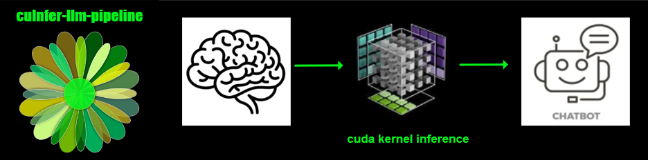

<p align="center">
  
</p>

# cuInfer LLM Pipeline

cuInfer-llm-pipeline is a C++ / CUDA repository for LLM inference components.
Development currently focuses on per-module tests under `tests/` rather than
end-to-end demos.

The project uses Bazel with [rules_cc](https://github.com/bazelbuild/rules_cc)
for C++ and [rules_python](https://github.com/bazelbuild/rules_python) for
Python tests. CUDA code is currently compiled with `nvcc` through Bazel
genrules and linked with the host code. Although
[rules_cuda](https://github.com/bazel-contrib/rules_cuda) provides CUDA rules
for Bazel, it is not currently configured in this repository.

## Repository Structure

The directory tree below shows the current workspace, including empty
placeholder directories. Generated Bazel symlinks, Python caches, and `.git`
are omitted.

```text
cuInfer-llm-pipeline/
├── asserts/
├── calculator/
│   ├── gemm/                 (empty placeholder)
│   ├── mhc/
│   └── moe/                  (empty placeholder)
├── kernel/
├── output/
├── python/
│   └── cuinfer_llm/
├── test/
│   ├── cpp_test/
│   └── python_test/
├── tests/
│   ├── common/
│   ├── cuda_hello/
│   ├── gemm/                 (empty placeholder)
│   ├── mhc/
│   └── moe/                  (empty placeholder)
├── .clang-format
├── .gitignore
├── LICENSE
├── MODULE.bazel
├── MODULE.bazel.lock
├── make.sh
├── README.md
└── startup_env.sh
```

Directory roles:

| Directory | Role |
| --- | --- |
| `asserts/` | Images used by the documentation. |
| `calculator/` | Inference operator implementations. |
| `calculator/mhc/` | mHC CUDA kernels, headers, shared-library interface, and Bazel build target. |
| `calculator/gemm/`, `calculator/moe/` | Empty placeholders for future operators. |
| `kernel/` | Other CUDA kernels and launch interfaces, including elementwise, RMSNorm, and unpermutation code. |
| `output/` | Binaries produced by the legacy `make.sh` workflow; the repository also contains existing binaries here. |
| `python/cuinfer_llm/` | Python package; `mhc.py` wraps the mHC shared library, while other modules are currently placeholders. |
| `test/cpp_test/` | Legacy C++/GTest CUDA tests built with `make.sh`. |
| `test/python_test/` | Legacy Python CUDA experiment. |
| `tests/common/` | Reserved location for shared test utilities; currently empty files. |
| `tests/cuda_hello/` | Bazel vector-add CUDA example and GTest. |
| `tests/mhc/` | Bazel mHC C++ and Python tests, PTX tests, and performance benchmark. |
| `tests/gemm/`, `tests/moe/` | Empty placeholders for future tests. |

Empty directories are not tracked by Git and may not appear in a fresh clone.
`MODULE.bazel` declares Bazel dependencies and toolchains; `make.sh` supports
the legacy C++ tests; `startup_env.sh` configures CUDA for the current shell.

## Environment Setup

The project has been used on WSL2 Ubuntu with an NVIDIA GPU. Install a
compatible NVIDIA driver, the CUDA Toolkit for WSL, Bazel with Bzlmod support,
a C++ compiler, and GTest. The Bazel CUDA targets currently use the toolkit at
`/usr/local/cuda` and the system GTest installation. On Ubuntu, the compiler
and GTest packages can be installed with:

```bash
sudo apt update
sudo apt install -y build-essential libgtest-dev
```

From the repository root, configure the current Bash session and check CUDA:

```bash
source startup_env.sh
nvcc --version
nvidia-smi
```

The script defaults to `/usr/local/cuda`; set `CUDA_HOME` before sourcing it
to select a different toolkit for shell-based workflows. This does not change
the `/usr/local/cuda` paths hard-coded in the Bazel targets. The script does
not install CUDA or modify shell startup files.

Python tests require a Python environment with CUDA-enabled PyTorch. For the
existing environment at `/mnt/c/Users/xincu/python-env`, activate it and return
to the repository root:

```bash
cd /mnt/c/Users/xincu/python-env
source .venv/bin/activate
cd /mnt/c/Users/xincu/cuInfer-llm-pipeline
```

Use your own environment and repository paths if they differ. The CUDA hello
test requires compute capability 7.5 or newer; mHC requires 8.0 or newer.
Nsight Systems is optional and is used for the mHC performance measurements.

## Test Modules

`bazel test` builds its dependencies before executing the tests. Run these
commands from the repository root:

| Module | Description | Documentation |
| --- | --- | --- |
| CUDA hello | CUDA vector-add correctness tests with GTest. | [CUDA hello README](tests/cuda_hello/README.md) |
| mHC | Post and pre big-fuse tests for CUDA C++, inline PTX, and Python, plus an Nsight Systems benchmark. | [mHC README](tests/mhc/README.md) |

```bash
bazel test //tests/cuda_hello:cuda_hello --nocache_test_results --test_output=errors
bazel test //tests/mhc:mhc_cpp_test --nocache_test_results --test_output=errors
bazel test //tests/mhc:mhc_python_test --test_env=PATH --nocache_test_results --test_output=errors
```

Activate the PyTorch environment before the Python command; `--test_env=PATH`
passes its `python3` to Bazel. The mHC C++ suite runs both CUDA C++ and PTX
cases by default; its README provides separate commands for each variant and
instructions for the benchmark.

### Legacy tests

The tests in `test/cpp_test/` use `make.sh` rather than the Bazel test modules.
They cover [elementwise](test/cpp_test/cuElementwiseCUDATest.cpp),
[RMSNorm](test/cpp_test/cuRmsNormCUDATest.cpp),
[reordering](test/cpp_test/cuReorderTest.cpp), and
[unpermutation](test/cpp_test/cuDeepSeekUnPermutationCUDATest.cpp). The
[Python elementwise experiment](test/python_test/elementwise.py) uses a
PyTorch CUDA extension.

For example:

```bash
./make.sh test/cpp_test/cuElementwiseCUDATest.cpp
./output/cuElementwiseCUDATest
```

`make.sh` writes to `output/<test-name>`, potentially replacing an existing
binary. It detects the GPU architecture with `nvidia-smi` (or uses `sm_89` as a
fallback); set `CUDA_ARCH` to override it. Tests including PyTorch headers,
such as `cuRmsNormCUDATest.cpp`, additionally require PyTorch and its runtime
libraries. `PYTHON` can select the interpreter used to locate PyTorch.
For example, after activating the PyTorch environment:

```bash
./make.sh test/cpp_test/cuRmsNormCUDATest.cpp
export LD_LIBRARY_PATH="$(python -c 'import os, torch; print(os.path.join(os.path.dirname(torch.__file__), "lib"))')${LD_LIBRARY_PATH:+:$LD_LIBRARY_PATH}"
./output/cuRmsNormCUDATest --gtest_filter=brRmsNormCUDAKernelTest.sanity
```

## License

This project is distributed under the [MIT License](LICENSE).
